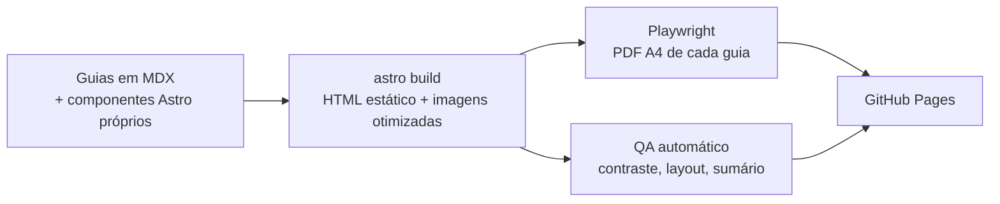

  

  <picture>
    <source media="(prefers-color-scheme: dark)" srcset="readme/logo-escuro.png">
    
  </picture>

<h1 align="center">Guild DIVINE</h1>

  <b>O manual da guilda para o conteúdo em grupo de Guild Wars 2.</b> 
  Raids, Fractals e Dungeons explicados em português, com vídeo de cada boss.

  
  
  

  
  
  
  
  

---

## Por onde começar

Nunca fez conteúdo em grupo? Leia o **Endgame** primeiro. Ele ensina o que os outros guias dão por sabido: boons, roles, builds, o Golem de treino e o ArcDPS. Depois escolha o modo de jogo que você quer aprender.

| | Guia | O que você aprende |
|:-:|---|:-:|
|  | **[Endgame](https://divinegw.github.io/guias/endgame.html)** comece por aqui | Tipos de dano, boons e conditions, Defiance Bar, atributos, roles, onde achar builds, Golem de treino, ArcDPS e como entrar num squad. |
|  | **[Raids](https://divinegw.github.io/guias/raids.html)** | As 8 wings e os Raid Encounters, recompensas, Emboldened, Challenge Mode e Legendary Mode, com vídeo de cada boss e um resumo do que muda no CM. |
|  | **[Fractals](https://divinegw.github.io/guias/fractals.html)** | Tiers e escalas, Agony Resistance, instabilidades, dailies, Ad Infinitum, títulos e o Challenge Mode das 7 Fractals que têm um. |
|  | **[Dungeons](https://divinegw.github.io/guias/dungeons.html)** | As 8 dungeons clássicas de Tyria: onde fica a entrada, recompensas, achievements e vídeo de cada path. |
|  | **[Recursos Úteis](https://divinegw.github.io/guias/recursos-uteis.html)** | 58 sites e ferramentas da comunidade (builds, conta, logs, gold, crafting, mapas, WvW e homestead), cada um com o que faz. |
|  | **[Divine Prisma](https://divinegw.github.io/guias/cursores.html)** | Cursores prismáticos feitos pela guilda: 21 desenhos, 7 cores e 5 tamanhos, com instalador para o Nexus. |

## Para baixar

- **[Configuração do Zyanore para o ArcDPS](https://divinegw.github.io/downloads/arcdps-zyanore.zip)**: o perfil de janelas de DPS do Zyanore, com a fonte e um passo a passo. O guia de [Endgame](https://divinegw.github.io/guias/endgame.html#arcdps) explica como instalar.
- **[Divine Prisma](https://github.com/divinegw/divine-prisma)**: os cursores, com instalador para o Nexus e versão `.cur` para o YoloMouse.

## O que tem no site

- **Sumário que acompanha a leitura.** Fica fixo ao lado do texto e marca a seção que está na tela. Clicou num item, a página para no título dele, no computador e no celular.
- **Busca.** Digite o nome de um boss, wing ou dungeon e vá direto para ele.
- **CM no lugar certo.** Em cada boss, o botão "O que muda" abre ali mesmo uma ficha com a vida do boss, as mecânicas novas e dicas, sem sair do guia.
- **Novidades com aviso.** Quando o site muda, o sino do topo ganha um ponto dourado e a página [Novidades](https://divinegw.github.io/novidades.html) diz o que mudou e onde.
- **Tema claro e escuro**, que segue o do seu sistema e troca num botão. No celular nada rola para o lado, e todo botão tem pelo menos 24 px para o toque.

## Como o site é feito

Os guias são escritos em MDX, com componentes próprios para boss, wing, dungeon, abas e avisos. O Astro transforma tudo em HTML estático. Depois o Playwright abre cada página num navegador de verdade, imprime os PDFs e roda os testes. Os testes rodam antes de cada publicação, e se a build ou algum PDF falhar, o script de publicação para sem enviar nada.

### O que os testes conferem antes de publicar

Cada página é testada em **4 combinações**: tema claro e escuro, computador e celular.

| Teste | O que ele pega |
|---|---|
| Contraste | Todo texto da página medido contra o fundo real, pela regra WCAG. |
| Layout | Rolagem para o lado, botões pequenos demais para o toque, títulos fora de ordem. |
| Imagens e erros | Imagem quebrada, banner no tamanho errado, erro no console do navegador. |
| Sumário | Clica em cada item de cada guia, com a rolagem suave ligada, e confere se o título parou logo abaixo do cabeçalho. |

### Por baixo do capô

- O Astro gera cada arte em várias larguras, em WebP, e o navegador baixa só a que cabe na tela.
- As abas seguem o padrão WAI-ARIA e funcionam pelo teclado (setas, Home e End). Toda imagem tem uma descrição do que mostra.
- Os endereços dos guias (`/guias/<guia>.html`) e as âncoras das seções não mudam. A guilda compartilha esses links no Discord, e link quebrado lá ninguém conserta.

## Créditos

- **Conteúdo:** membros da guilda DIVINE. O autor de cada guia aparece no topo dele.
- **Ilustrações:** feitas pela guilda a partir de artes, capturas e telas de carregamento de Guild Wars 2 e de prints tirados no jogo pela guilda e por jogadores da comunidade, mudando só o estilo.
- **Guild Wars 2:** nomes, artes e ícones do jogo pertencem à ArenaNet e são usados conforme os [Content Terms of Use](https://www.arena.net/en/legal/content-terms-of-use). Este é um site de fã, sem fins comerciais e sem vínculo com a ArenaNet.
- **Ícones e fontes:** [Lucide](https://lucide.dev) (ISC), Mona Sans e Geist Mono (SIL Open Font License, com as licenças em `assets/fonts/`).

A lista completa, com cada imagem da Guild Wars 2 Wiki, cada canal de vídeo e cada licença, está na página de [Créditos](https://divinegw.github.io/creditos.html).

---

Este repositório guarda o site já gerado, que o GitHub Pages publica. O código-fonte e o guia de edição ficam com quem mantém o site. Achou um erro num guia? Avise no <a href="https://discord.gg/7fHMRW2xvt">Discord da guilda</a>.
